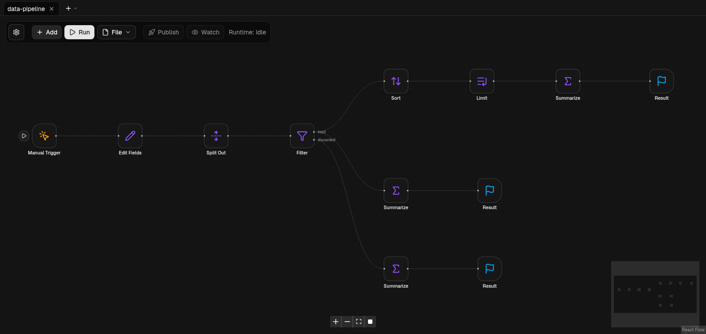

<div align="center">

# FL0W

**A self-hosted, visual workflow automation tool — an open-source alternative to n8n that runs on your own machine with plain Node.js.**

**English** · [Русский](docs/readme_ru.md) · [中文](docs/readme_zh.md)



</div>

## What is FL0W

FL0W lets you build automations by dragging **blocks** onto a canvas and wiring their ports together: receive a webhook,
poll a mailbox, answer a Telegram bot, call an HTTP API, transform the data, write a file, open a Jira issue, show a
desktop notification. Flows are saved as plain JSON, run **locally** in your own Node.js processes, and can be
**published** so that their triggers keep working in the background — no cloud account, no external database, nothing
phones home.

It is in the same space as [n8n](https://n8n.io): a node-based editor with triggers, expressions, scheduling,
debugging tools and ready-made integrations. FL0W is an independent, from-scratch implementation with a deliberately
smaller and simpler execution model (see [FL0W and n8n](#fl0w-and-n8n)).

### Highlights

- **Visual editor** — canvas with drag-and-drop blocks, typed ports, groups and sticky notes, snap-to-grid, minimap,
  several flows in tabs, undo/redo, copy/cut/paste (also between tabs and browsers), keyboard-driven "add block" search,
  light/dark theme, English and Russian interface.
- **54 built-in blocks** — triggers, HTTP, files, data transforms, loops, flow control, Telegram, Jira, mail, desktop
  notifications, JWT/crypto, a sandboxed Code block and an AI-style *Code Agent* with tools and memory
  (see [the block reference](docs/BLOCKS.md)).
- **Triggers** — manual, interval, webhook, Telegram (long polling or webhook), new e-mail (IMAP or Microsoft Graph),
  local file changes, flow errors, flow activation/update, and calls from other flows.
- **Real isolation** — every flow run is a separate Node.js process with a timeout; a run can be cancelled, a trial run can
  be paused and resumed. Nothing a flow does can take the editor down.
- **Debugging that helps** — per-node input / resolved parameters / output / log / error, **pin data**, **re-run from a
  node**, per-node **run buttons** on triggers, **disable** a node, live **Watch** of published flows, and live validation
  with problems highlighted on the canvas.
- **Flows that talk to each other** — *Emitter* / *Collector* blocks call another flow over a named channel
  (wait for the answer, or fire and forget); a *Loop* block iterates over lists, counts, or `while` conditions with *Break*.
- **Safe by default** — the editor is meant for a trusted network; the `Shell` block is off unless you enable it, file
  access is confined to one directory, secrets live in environment variables, and user code only runs in the `Code`
  block inside a `vm` sandbox.
- **Easy to run** — `pnpm install && pnpm build && pnpm start`, or one `docker compose up`. Flows, memory and files live in
  plain directories / Docker volumes that survive container removal.

## FL0W and n8n

FL0W is **inspired by n8n** and borrows its good ideas — a node canvas, triggers, expressions, pin data, "execute from
here", error workflows, a Code node — but it is **not** a fork, contains no n8n code and is **not affiliated with or
endorsed by n8n GmbH**. "n8n" is a trademark of its owner and is used here only to describe what FL0W is comparable to.

| | n8n | FL0W |
|---|---|---|
| Visual node editor, triggers, scheduling, webhooks | yes | yes |
| Data model | arrays of *items* flowing through every node | **one JSON value per port**; an empty output means "this branch is not taken" |
| Expressions | JavaScript in `{{ }}` | declarative `{{ path }}` templates and `{{ inputs.in0.path }}` — no code is evaluated outside the `Code` block |
| Looping | Loop Over Items / Split In Batches | a real **Loop** block (items / count / while / forever) with a body subgraph and **Break** |
| Sub-workflows | Execute Workflow | **Emitter / Collector** blocks, strictly 1:1 over a channel id, `await` or `shoot` mode |
| Debugging | pin data, partial executions | pin data, **re-run from a node**, per-node data window, trial run **pause/stop**, **sandbox ≠ production** isolation |
| Credentials | encrypted credential store | **environment variables** (`env:FL0W_SECRET_…`) or inline values; no credential database |
| Users | multi-user, projects, roles | **single-user, no authentication** — put it behind a reverse proxy / VPN if it is reachable by others |
| Scale | queue mode, workers | one server process, one child process per run |
| Integrations | hundreds | 54 blocks: HTTP, Telegram, Jira/Atlassian, mail (IMAP/SMTP/Graph), files, Shell, JWT, crypto, notifications, … |
| Extensibility | community nodes (npm) | blocks are TypeScript classes added in code ([`packages/blocks`](packages/blocks)) |
| Binary data | yes | no — the model is JSON-only (files are read/written inside the files directory) |
| License | Sustainable Use License (fair-code) | **GPL-2.0-only** |

Where FL0W is *different on purpose*: fewer concepts, no hidden state, predictable execution (a flow is a run-once DAG;
parallel branches run in parallel), and no server-side secrets store to protect. Where it is *simply not there yet*:
queue mode, user management, a credentials manager, binary items, WebSocket and SSH blocks — see
[`docs/BACKLOG.md`](docs/BACKLOG.md).

## Quick start

### Requirements

- **Node.js 26** (the version the project is developed and tested on) and **pnpm 11** (`npm install -g pnpm@11`).
- Optional: Docker, `notify-send` (libnotify) for desktop notifications.

### Run locally

```bash
git clone https://github.com/miloserdev/fl0w.git
cd fl0w
pnpm install
pnpm build
pnpm start          # → http://localhost:3000
```

For development with hot reload use `pnpm dev` instead of the last two commands (also http://localhost:3000).

Flows, memory banks and files are stored under `apps/web/.data/` by default (see [configuration](#configuration)).

Another port: `PORT=3001 pnpm start` (or `PORT=3001 pnpm dev`). If `pnpm install` times out on a slow connection, retry with
`pnpm install --fetch-timeout 600000` — packages that were already downloaded are reused.

### Run with Docker

```bash
cp .env.example .env          # optional: port, Shell, secrets, host directories
docker compose up -d --build  # → http://127.0.0.1:3000
```

Data lives in Docker volumes (`fl0w-data`, `fl0w-files`) or in host directories you choose, and **survives container
removal**. Do not run `docker compose down -v` unless you want the volumes deleted. A ready-made image can be used with
`FL0W_IMAGE=ghcr.io/<you>/fl0w:<tag> docker compose up -d`. Details: [`docs/DEPLOY.md`](docs/DEPLOY.md).

### Your first flow

1. Open the editor, click **Add**, search for *Manual Trigger* and press **Enter**; add a *Result* block the same way.
2. Drag from the output dot of the trigger to the input dot of the result.
3. Press **Run**. The result appears in the panel on the right; click any node to inspect its data.
4. To make a flow work in the background, add a trigger such as *Webhook* or *Every* and press **Publish**.

Example flows live in [`examples/`](examples) — open one with **File → Open**.

## Configuration

Everything is configured with environment variables (with Docker, put them in `.env`; template: [`.env.example`](.env.example)).

| Variable | Purpose | Default |
|---|---|---|
| `FL0W_DATA_DIR` | where flows are stored | `apps/web/.data/flows` (`/data/flows` in the image) |
| `FL0W_MEMORY_DIR` | memory banks and counters | `apps/web/.data/memory` (`/data/memory`) |
| `FL0W_FILES_DIR` | the only directory the Files, Local File Trigger and Shell blocks can touch | `apps/web/.data/files` (`/data/files`) |
| `FL0W_ALLOW_SHELL` | `1` enables the **Shell** block (runs commands on the server) | off |
| `FL0W_PUBLIC_URL` | public https URL of the server (Telegram webhooks) | unset |
| `FL0W_TELEGRAM_API` | custom Telegram Bot API server | `https://api.telegram.org` |
| `FL0W_GRAPH_URL`, `FL0W_GRAPH_LOGIN_URL` | Microsoft Graph endpoints (national clouds) | Microsoft public cloud |
| `FL0W_SECRET_*` | secrets, referenced from block parameters as `env:FL0W_SECRET_NAME` | unset |

Docker Compose only: `FL0W_PORT`, `FL0W_BIND` (default `127.0.0.1`), `FL0W_IMAGE`, `FL0W_DATA`, `FL0W_FILES`.

## Security model

FL0W has **no authentication**: anyone who can reach the port can edit and run flows. Keep it on `localhost`, or put a
reverse proxy / VPN with authentication in front of it (Compose binds to `127.0.0.1` by default). Webhook and Telegram
routes (`/api/hooks/…`, `/api/telegram/…`) may need to be reachable from outside — proxy only those if you can.

The `Shell` block is disabled unless `FL0W_ALLOW_SHELL=1`, file blocks cannot leave `FL0W_FILES_DIR`, and secrets are
stripped from errors, logs and run events. Block-level details are in [`docs/BLOCKS.md`](docs/BLOCKS.md#environment-and-security).

## Project layout

```
apps/web          Next.js editor and HTTP API (/api/run, /api/flows, /api/hooks, …)
packages/schema   zod schemas: flows, runner protocol
packages/blocks   all blocks (isomorphic TypeScript classes) and the registry
packages/engine   validation, run engine, process runner, flow store, scheduler, pollers
examples/         ready-to-open example flows (tested)
docs/             block reference, deployment, backlog, translated READMEs
scripts/          docker build/publish, UI check, commit helper
```

## Development

```bash
pnpm check     # typecheck + lint + all tests
pnpm verify    # the same plus a production build of the web app
```

Maintainer and contributor rules are in [`CLAUDE.md`](CLAUDE.md) (the project is developed with an AI coding agent);
the architecture rules that apply to every change are summarised there.

## License

FL0W is licensed under the **GNU General Public License, version 2 only** (`GPL-2.0-only`) — the same license as the
Linux kernel. See [`LICENSE`](LICENSE). Individual source files intentionally carry no license headers; the license
of the whole repository is the one in `LICENSE`. Third-party components keep their own licenses — see
[`docs/THIRD_PARTY_NOTICES.md`](docs/THIRD_PARTY_NOTICES.md).

n8n is a trademark of n8n GmbH. Atlassian and Jira are trademarks of Atlassian. Microsoft, Outlook and Microsoft Graph are
trademarks of Microsoft. Telegram is a trademark of Telegram FZ-LLC. Linux is a trademark of Linus Torvalds. All product
names are used only to identify the services FL0W can talk to, and FL0W is not affiliated with or endorsed by any of them.
