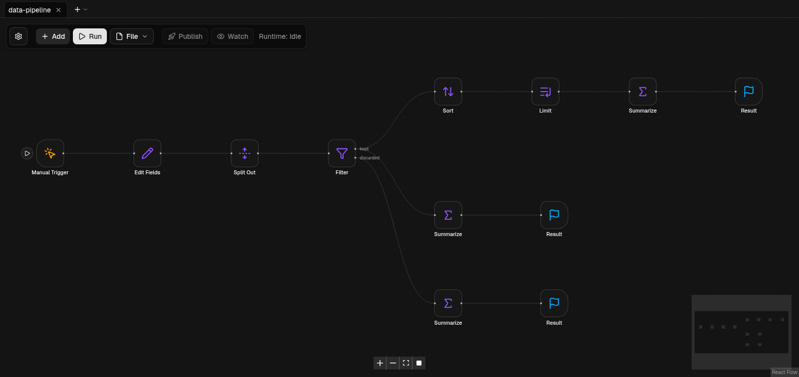

<div align="center">

# FL0W

**Self-hosted визуальная автоматизация потоков — открытая альтернатива n8n, которая работает на вашей машине на чистом Node.js.**

[English](../README.md) · **Русский** · [中文](readme_zh.md)



</div>

## Что такое FL0W

В FL0W вы собираете автоматизации, перетаскивая на холст **блоки** и соединяя их порты: принять вебхук, опросить почтовый
ящик, ответить Telegram-боту, вызвать HTTP API, преобразовать данные, записать файл, завести задачу в Jira, показать
уведомление на рабочем столе. Флоу хранится обычным JSON, исполняется **локально** в ваших процессах Node.js и может быть
**опубликован** — тогда его триггеры работают в фоне. Ни облачного аккаунта, ни внешней базы данных, ничего не уходит наружу.

По назначению это то же, что [n8n](https://n8n.io): редактор на нодах, триггеры, выражения, расписание, инструменты
отладки и готовые интеграции. FL0W — независимая реализация с нуля, сознательно с более простой моделью исполнения
(см. [FL0W и n8n](#fl0w-и-n8n)).

### Главное

- **Визуальный редактор** — холст с блоками, типизированными портами, группами и заметками, привязкой к сетке, миникартой,
  несколькими флоу во вкладках, отменой/повтором, копированием/вырезанием/вставкой (в том числе между вкладками и
  браузерами), поиском блока с клавиатуры, светлой и тёмной темой, интерфейсом на русском и английском.
- **54 встроенных блока** — триггеры, HTTP, файлы, преобразования данных, циклы, управление потоком, Telegram, Jira, почта,
  уведомления рабочего стола, JWT/криптография, блок Code в песочнице и *Code Agent* с инструментами и памятью
  (см. [справочник блоков](BLOCKS.md)).
- **Триггеры** — ручной, по интервалу, вебхук, Telegram (long polling или вебхук), новое письмо (IMAP или Microsoft Graph),
  изменения файлов, ошибки флоу, активация/обновление флоу и вызовы из других флоу.
- **Настоящая изоляция** — каждый запуск флоу — отдельный процесс Node.js с тайм-аутом; запуск можно отменить, пробный
  запуск — поставить на паузу и продолжить. Что бы ни делал флоу, редактор он не уронит.
- **Отладка, которая помогает** — по каждой ноде вход / подставленные параметры / выход / лог / ошибка, **закрепление данных
  (pin data)**, **перезапуск с ноды**, кнопки запуска на триггерах, **отключение** ноды, **Watch** за опубликованными флоу
  в реальном времени и живая проверка с подсветкой проблем на холсте.
- **Флоу общаются друг с другом** — блоки *Emitter* / *Collector* вызывают другой флоу по именованному каналу (с ожиданием
  ответа или без); блок *Loop* перебирает списки, считает или работает по условию `while`, есть *Break*.
- **Безопасные настройки по умолчанию** — редактор рассчитан на доверенную сеть, блок `Shell` выключен, пока вы его не
  включите, доступ к файлам ограничен одним каталогом, секреты лежат в переменных окружения, а пользовательский код
  исполняется только в блоке `Code` внутри песочницы `vm`.
- **Просто запустить** — `pnpm install && pnpm build && pnpm start` или один `docker compose up`. Флоу, память и файлы лежат
  в обычных каталогах / томах Docker и переживают удаление контейнера.

## FL0W и n8n

FL0W **вдохновлён n8n** и берёт его удачные идеи — холст из нод, триггеры, выражения, pin data, «выполнить отсюда», флоу
для ошибок, блок Code, — но **не является форком**, не содержит кода n8n и **не связан с n8n GmbH и не одобрен ею**.
«n8n» — товарный знак его владельца; здесь он используется только для описания того, с чем сопоставим FL0W.

| | n8n | FL0W |
|---|---|---|
| Визуальный редактор, триггеры, расписание, вебхуки | да | да |
| Модель данных | массивы *items* через каждую ноду | **один JSON на порт**; пустой выход — «эта ветка не идёт» |
| Выражения | JavaScript в `{{ }}` | декларативные шаблоны `{{ путь }}` и `{{ inputs.in0.путь }}` — код вне блока `Code` не исполняется |
| Циклы | Loop Over Items / Split In Batches | настоящий блок **Loop** (items / count / while / forever) с телом-подграфом и **Break** |
| Вложенные флоу | Execute Workflow | блоки **Emitter / Collector**, строго 1:1 по id канала, режимы `await` и `shoot` |
| Отладка | pin data, частичные запуски | pin data, **перезапуск с ноды**, окно данных ноды, **пауза/стоп** пробного запуска, изоляция **песочница ≠ production** |
| Учётные данные | зашифрованное хранилище credentials | **переменные окружения** (`env:FL0W_SECRET_…`) или значения в параметрах; базы учётных данных нет |
| Пользователи | многопользовательский режим, проекты, роли | **один пользователь, без аутентификации** — если доступ есть у других, поставьте обратный прокси / VPN |
| Масштабирование | queue mode, воркеры | один серверный процесс, на каждый запуск — дочерний процесс |
| Интеграции | сотни | 54 блока: HTTP, Telegram, Jira/Atlassian, почта (IMAP/SMTP/Graph), файлы, Shell, JWT, криптография, уведомления, … |
| Расширяемость | community-ноды (npm) | блоки — классы TypeScript, добавляются в коде ([`packages/blocks`](../packages/blocks)) |
| Бинарные данные | да | нет — модель только JSON (файлы читаются и пишутся в каталоге файлов) |
| Лицензия | Sustainable Use License (fair-code) | **GPL-2.0-only** |

Что *отличается намеренно*: меньше понятий, нет скрытого состояния, предсказуемое исполнение (флоу — DAG, выполняемый один
раз; параллельные ветки идут параллельно), не нужно защищать серверное хранилище секретов. Чего *просто ещё нет*:
queue mode, управления пользователями, менеджера credentials, бинарных данных, блоков WebSocket и SSH — см.
[`BACKLOG.md`](BACKLOG.md).

## Быстрый старт

### Требования

- **Node.js 26** (на ней проект разрабатывается и проверяется) и **pnpm 11** (`npm install -g pnpm@11`).
- По желанию: Docker, `notify-send` (libnotify) для уведомлений рабочего стола.

### Локальный запуск

```bash
git clone https://github.com/miloserdev/fl0w.git
cd fl0w
pnpm install
pnpm build
pnpm start          # → http://localhost:3000
```

Для разработки с горячей перезагрузкой вместо последних двух команд — `pnpm dev` (тоже http://localhost:3000).

Флоу, банки памяти и файлы по умолчанию лежат в `apps/web/.data/` (см. [настройка](#настройка)).

Другой порт: `PORT=3001 pnpm start` (или `PORT=3001 pnpm dev`). Если `pnpm install` обрывается по тайм-ауту на медленной сети, повторите с
`pnpm install --fetch-timeout 600000` — уже скачанные пакеты используются повторно.

### Запуск в Docker

```bash
cp .env.example .env          # по желанию: порт, Shell, секреты, каталоги хоста
docker compose up -d --build  # → http://127.0.0.1:3000
```

Данные лежат в томах Docker (`fl0w-data`, `fl0w-files`) или в выбранных вами каталогах хоста и **переживают удаление
контейнера**. Не запускайте `docker compose down -v`, если не хотите удалить тома. Готовый образ:
`FL0W_IMAGE=ghcr.io/<вы>/fl0w:<тег> docker compose up -d`. Подробности — [`DEPLOY.md`](DEPLOY.md).

### Первый флоу

1. Откройте редактор, нажмите **Добавить**, найдите *Ручной запуск* и нажмите **Enter**; так же добавьте блок *Результат*.
2. Протяните связь от выходной точки триггера к входной точке результата.
3. Нажмите **Запустить**. Результат появится в панели справа; щёлкните по любой ноде, чтобы увидеть её данные.
4. Чтобы флоу работал в фоне, добавьте триггер (например, *Вебхук* или *Каждые N*) и нажмите **Опубликовать**.

Примеры флоу лежат в [`examples/`](../examples) — откройте любой через **Файл → Открыть**.

## Настройка

Всё настраивается переменными окружения (в Docker — файл `.env`, шаблон — [`.env.example`](../.env.example)).

| Переменная | Назначение | По умолчанию |
|---|---|---|
| `FL0W_DATA_DIR` | где хранятся флоу | `apps/web/.data/flows` (`/data/flows` в образе) |
| `FL0W_MEMORY_DIR` | банки памяти и счётчики | `apps/web/.data/memory` (`/data/memory`) |
| `FL0W_FILES_DIR` | единственный каталог, доступный блокам Files, Local File Trigger и Shell | `apps/web/.data/files` (`/data/files`) |
| `FL0W_ALLOW_SHELL` | `1` включает блок **Shell** (команды на сервере) | выключен |
| `FL0W_PUBLIC_URL` | публичный https-адрес сервера (вебхуки Telegram) | не задан |
| `FL0W_TELEGRAM_API` | свой сервер Telegram Bot API | `https://api.telegram.org` |
| `FL0W_GRAPH_URL`, `FL0W_GRAPH_LOGIN_URL` | адреса Microsoft Graph (национальные облака) | публичное облако Microsoft |
| `FL0W_SECRET_*` | секреты; в параметрах блоков — `env:FL0W_SECRET_ИМЯ` | не заданы |

Только для Docker Compose: `FL0W_PORT`, `FL0W_BIND` (по умолчанию `127.0.0.1`), `FL0W_IMAGE`, `FL0W_DATA`, `FL0W_FILES`.

## Модель безопасности

В FL0W **нет аутентификации**: кто достучится до порта, тот может редактировать и запускать флоу. Держите сервис на
`localhost` или поставьте перед ним обратный прокси / VPN с авторизацией (Compose по умолчанию привязывается к
`127.0.0.1`). Маршруты вебхуков и Telegram (`/api/hooks/…`, `/api/telegram/…`) могут быть нужны снаружи — по возможности
проксируйте только их.

Блок `Shell` выключен без `FL0W_ALLOW_SHELL=1`, файловые блоки не выходят за `FL0W_FILES_DIR`, секреты вырезаются из
ошибок, логов и событий запуска. Подробности по блокам — [`BLOCKS.md`](BLOCKS.md#environment-and-security).

## Структура проекта

```
apps/web          редактор на Next.js и HTTP API (/api/run, /api/flows, /api/hooks, …)
packages/schema   zod-схемы: флоу, протокол раннера
packages/blocks   все блоки (изоморфные классы TypeScript) и реестр
packages/engine   валидация, движок, процесс-раннер, хранилище флоу, планировщик, опросы
examples/         готовые примеры флоу (проверяются тестами)
docs/             справочник блоков, развёртывание, backlog, переводы README
scripts/          сборка и публикация docker-образа, проверка UI, помощник коммитов
```

## Разработка

```bash
pnpm check     # типы + линт + все тесты
pnpm verify    # то же плюс production-сборка web
```

Правила для сопровождающих и участников — в [`CLAUDE.md`](../CLAUDE.md) (проект разрабатывается вместе с ИИ-агентом);
архитектурные правила, действующие для любого изменения, собраны там же.

## Лицензия

FL0W распространяется под **GNU General Public License версии 2 only** (`GPL-2.0-only`) — той же лицензией, что и ядро
Linux. См. [`LICENSE`](../LICENSE). В отдельных исходных файлах заголовков лицензии намеренно нет: лицензия всего
репозитория — та, что в `LICENSE`. Сторонние компоненты сохраняют свои лицензии — см.
[`THIRD_PARTY_NOTICES.md`](THIRD_PARTY_NOTICES.md).

n8n — товарный знак n8n GmbH. Atlassian и Jira — товарные знаки Atlassian. Microsoft, Outlook и Microsoft Graph —
товарные знаки Microsoft. Telegram — товарный знак Telegram FZ-LLC. Linux — товарный знак Линуса Торвальдса. Названия
продуктов используются только для обозначения сервисов, с которыми умеет работать FL0W; FL0W не связан с ними и не
одобрен ими.
