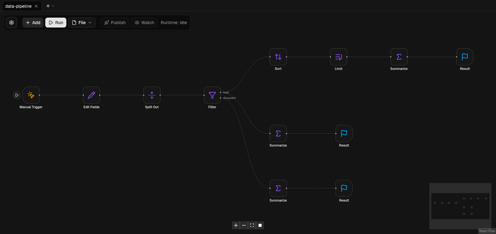

<div align="center">

# FL0W

**自托管的可视化工作流自动化工具——开源的 n8n 替代品，只需纯 Node.js 即可在你自己的机器上运行。**

[English](../README.md) · [Русский](readme_ru.md) · **中文**



</div>

## FL0W 是什么

在 FL0W 中，你把**块（block）**拖到画布上并连接它们的端口，就能搭建自动化流程：接收 Webhook、轮询邮箱、回复
Telegram 机器人、调用 HTTP API、转换数据、写入文件、在 Jira 中创建任务、弹出桌面通知。流程（flow）以普通 JSON 保存，
在你自己的 Node.js 进程里**本地**运行，并且可以**发布**，让它的触发器在后台持续工作。无需云账号，无需外部数据库，
也不会向外发送任何数据。

它与 [n8n](https://n8n.io) 定位相近：基于节点的编辑器、触发器、表达式、定时调度、调试工具和现成的集成。
FL0W 是完全独立、从零实现的项目，执行模型有意做得更小更简单（见 [FL0W 与 n8n](#fl0w-与-n8n)）。

### 亮点

- **可视化编辑器**——拖拽式画布，带类型的端口，分组与便签，网格吸附，小地图，多个流程以标签页并存，撤销/重做，
  复制/剪切/粘贴（可跨标签页和浏览器），键盘搜索添加块，亮色/暗色主题，英文和俄文界面。
- **54 个内置块**——触发器、HTTP、文件、数据转换、循环、流程控制、Telegram、Jira、邮件、桌面通知、JWT/加密、
  沙箱化的 Code 块，以及带工具和记忆的 *Code Agent*（见[块参考](BLOCKS.md)）。
- **触发器**——手动、定时间隔、Webhook、Telegram（长轮询或 Webhook）、新邮件（IMAP 或 Microsoft Graph）、本地文件变化、
  流程错误、流程激活/更新，以及来自其他流程的调用。
- **真正的隔离**——每次流程运行都是带超时的独立 Node.js 进程；运行可以取消，试运行可以暂停和继续。
  流程里发生的任何事都不会拖垮编辑器。
- **真正有用的调试**——每个节点的输入 / 代入后的参数 / 输出 / 日志 / 错误、**固定数据（pin data）**、**从某个节点重新运行**、
  触发器上的运行按钮、**禁用**节点、对已发布流程的实时 **Watch**，以及在画布上高亮问题的实时校验。
- **流程之间可以互相调用**——*Emitter* / *Collector* 块通过具名通道调用另一个流程（等待结果或发出即忘）；
  *Loop* 块可遍历列表、计数或按 `while` 条件循环，并带有 *Break*。
- **默认安全**——编辑器面向可信网络；`Shell` 块默认关闭；文件访问被限制在一个目录内；密钥放在环境变量中；
  用户代码只在 `Code` 块的 `vm` 沙箱中执行。
- **运行简单**——`pnpm install && pnpm build && pnpm start`，或一条 `docker compose up`。流程、记忆和文件保存在普通目录或
  Docker 卷中，删除容器后依然保留。

## FL0W 与 n8n

FL0W **受 n8n 启发**，借鉴了它的好点子——节点画布、触发器、表达式、pin data、“从这里执行”、错误流程、Code 节点——但它
**不是分支（fork）**，不包含任何 n8n 代码，**与 n8n GmbH 无关，也未获其认可**。“n8n”是其所有者的商标，这里仅用于说明
FL0W 可与之比较。

| | n8n | FL0W |
|---|---|---|
| 可视化节点编辑器、触发器、定时、Webhook | 有 | 有 |
| 数据模型 | 每个节点之间传递 *items* 数组 | **每个端口一个 JSON 值**；空输出表示“该分支不执行” |
| 表达式 | `{{ }}` 中的 JavaScript | 声明式模板 `{{ 路径 }}` 与 `{{ inputs.in0.路径 }}`——`Code` 块之外不会执行任何代码 |
| 循环 | Loop Over Items / Split In Batches | 真正的 **Loop** 块（items / count / while / forever），带子图循环体和 **Break** |
| 子流程 | Execute Workflow | **Emitter / Collector** 块，通道 id 严格 1:1，`await` 或 `shoot` 两种模式 |
| 调试 | pin data、部分执行 | pin data、**从节点重新运行**、节点数据窗口、试运行**暂停/停止**、**沙箱 ≠ 生产**隔离 |
| 凭据 | 加密的凭据存储 | **环境变量**（`env:FL0W_SECRET_…`）或参数中直接填写；没有凭据数据库 |
| 用户 | 多用户、项目、角色 | **单用户、无认证**——若他人可访问，请放在反向代理 / VPN 之后 |
| 扩展性 | 队列模式、worker | 一个服务进程，每次运行一个子进程 |
| 集成 | 数百个 | 54 个块：HTTP、Telegram、Jira/Atlassian、邮件（IMAP/SMTP/Graph）、文件、Shell、JWT、加密、通知…… |
| 可扩展性 | 社区节点（npm） | 块是 TypeScript 类，在代码中添加（[`packages/blocks`](../packages/blocks)） |
| 二进制数据 | 支持 | 不支持——模型仅限 JSON（文件在文件目录内读写） |
| 许可证 | Sustainable Use License（fair-code） | **GPL-2.0-only** |

FL0W *有意不同*之处：概念更少、没有隐藏状态、执行可预测（流程是只运行一次的 DAG；并行分支并行运行）、无需保护服务端密钥库。
*暂时还没有*的：队列模式、用户管理、凭据管理器、二进制数据、WebSocket 与 SSH 块——见 [`BACKLOG.md`](BACKLOG.md)。

## 快速开始

### 环境要求

- **Node.js 26**（项目开发和测试所用版本）和 **pnpm 11**（`npm install -g pnpm@11`）。
- 可选：Docker；桌面通知需要 `notify-send`（libnotify）。

### 本地运行

```bash
git clone https://github.com/miloserdev/fl0w.git
cd fl0w
pnpm install
pnpm build
pnpm start          # → http://localhost:3000
```

开发时若需热重载，用 `pnpm dev` 代替最后两条命令（同样是 http://localhost:3000）。

流程、记忆库和文件默认保存在 `apps/web/.data/`（见[配置](#配置)）。

换端口：`PORT=3001 pnpm start`（或 `PORT=3001 pnpm dev`）。若在慢速网络下 `pnpm install` 超时，请用
`pnpm install --fetch-timeout 600000` 重试——已下载的包会被复用。

### 使用 Docker 运行

```bash
cp .env.example .env          # 可选：端口、Shell、密钥、宿主机目录
docker compose up -d --build  # → http://127.0.0.1:3000
```

数据保存在 Docker 卷（`fl0w-data`、`fl0w-files`）或你指定的宿主机目录中，**删除容器后依然保留**。除非想删除这些卷，
否则不要运行 `docker compose down -v`。使用现成镜像：`FL0W_IMAGE=ghcr.io/<你>/fl0w:<标签> docker compose up -d`。
详情见 [`DEPLOY.md`](DEPLOY.md)。

### 你的第一个流程

1. 打开编辑器，点击 **添加**，搜索 *手动触发* 并按 **Enter**；用同样方式添加 *结果* 块。
2. 从触发器的输出点拖线到结果块的输入点。
3. 点击 **运行**。结果显示在右侧面板；点击任意节点可查看它的数据。
4. 想让流程在后台工作，添加 *Webhook* 或 *Every* 等触发器并点击 **发布**。

示例流程在 [`examples/`](../examples) 中——通过 **文件 → 打开** 即可载入。

## 配置

一切通过环境变量配置（Docker 下写在 `.env` 中；模板见 [`.env.example`](../.env.example)）。

| 变量 | 用途 | 默认值 |
|---|---|---|
| `FL0W_DATA_DIR` | 流程存放位置 | `apps/web/.data/flows`（镜像中为 `/data/flows`） |
| `FL0W_MEMORY_DIR` | 记忆库和计数器 | `apps/web/.data/memory`（`/data/memory`） |
| `FL0W_FILES_DIR` | Files、Local File Trigger 和 Shell 块唯一可访问的目录 | `apps/web/.data/files`（`/data/files`） |
| `FL0W_ALLOW_SHELL` | `1` 启用 **Shell** 块（在服务器上执行命令） | 关闭 |
| `FL0W_PUBLIC_URL` | 服务器的公网 https 地址（Telegram Webhook） | 未设置 |
| `FL0W_TELEGRAM_API` | 自建 Telegram Bot API 服务器 | `https://api.telegram.org` |
| `FL0W_GRAPH_URL`、`FL0W_GRAPH_LOGIN_URL` | Microsoft Graph 地址（国家云） | Microsoft 公有云 |
| `FL0W_SECRET_*` | 密钥，在块参数中以 `env:FL0W_SECRET_名称` 引用 | 未设置 |

仅 Docker Compose：`FL0W_PORT`、`FL0W_BIND`（默认 `127.0.0.1`）、`FL0W_IMAGE`、`FL0W_DATA`、`FL0W_FILES`。

## 安全模型

FL0W **没有认证**：能访问端口的人就能编辑和运行流程。请让它只监听 `localhost`，或在前面放置带认证的反向代理 / VPN
（Compose 默认绑定到 `127.0.0.1`）。Webhook 和 Telegram 路由（`/api/hooks/…`、`/api/telegram/…`）可能需要对外可达——
如有可能，只代理这些路由。

未设置 `FL0W_ALLOW_SHELL=1` 时 `Shell` 块不可用；文件类块无法离开 `FL0W_FILES_DIR`；密钥会从错误、日志和运行事件中剔除。
各块的详细说明见 [`BLOCKS.md`](BLOCKS.md#environment-and-security)。

## 项目结构

```
apps/web          Next.js 编辑器和 HTTP API（/api/run、/api/flows、/api/hooks 等）
packages/schema   zod 模式：流程、运行器协议
packages/blocks   所有块（同构的 TypeScript 类）及注册表
packages/engine   校验、运行引擎、进程运行器、流程存储、调度器、轮询器
examples/         可直接打开的示例流程（有测试覆盖）
docs/             块参考、部署、待办事项、翻译版 README
scripts/          docker 构建/发布、UI 检查、提交辅助脚本
```

## 开发

```bash
pnpm check     # 类型检查 + lint + 全部测试
pnpm verify    # 同上，外加 web 的生产构建
```

维护者和贡献者规则见 [`CLAUDE.md`](../CLAUDE.md)（本项目与 AI 编码代理协作开发）；适用于所有改动的架构规则也汇总在其中。

## 许可证

FL0W 采用 **GNU 通用公共许可证第 2 版 only**（`GPL-2.0-only`）——与 Linux 内核相同的许可证。见 [`LICENSE`](../LICENSE)。
各源文件有意不带许可证头；整个仓库的许可证以 `LICENSE` 为准。第三方组件保留各自的许可证——见
[`THIRD_PARTY_NOTICES.md`](THIRD_PARTY_NOTICES.md)。

n8n 是 n8n GmbH 的商标。Atlassian 和 Jira 是 Atlassian 的商标。Microsoft、Outlook 和 Microsoft Graph 是 Microsoft 的商标。
Telegram 是 Telegram FZ-LLC 的商标。Linux 是 Linus Torvalds 的商标。所有产品名称仅用于说明 FL0W 可对接的服务，
FL0W 与它们无关联，也未获其认可。
